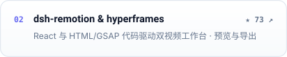

  <picture>
    <source media="(prefers-color-scheme: dark)" srcset="./assets/hero-dark.svg">
    <source media="(prefers-color-scheme: light)" srcset="./assets/hero-light.svg">
    
  </picture>

  <a href="https://github.com/STARDUSTLC666/dsh-email"><picture><source media="(prefers-color-scheme: dark)" srcset="./assets/card-01-email-dark.svg"><source media="(prefers-color-scheme: light)" srcset="./assets/card-01-email-light.svg"></picture></a>&nbsp;&nbsp;<a href="https://github.com/STARDUSTLC666/dsh-remotion"><picture><source media="(prefers-color-scheme: dark)" srcset="./assets/card-02-video-dark.svg"><source media="(prefers-color-scheme: light)" srcset="./assets/card-02-video-light.svg"></picture></a>

  <a href="https://github.com/STARDUSTLC666/dsh-ppt"><picture><source media="(prefers-color-scheme: dark)" srcset="./assets/card-03-ppt-dark.svg"><source media="(prefers-color-scheme: light)" srcset="./assets/card-03-ppt-light.svg"></picture></a>&nbsp;&nbsp;<a href="https://github.com/STARDUSTLC666/dsh-dream"><picture><source media="(prefers-color-scheme: dark)" srcset="./assets/card-04-dream-dark.svg"><source media="(prefers-color-scheme: light)" srcset="./assets/card-04-dream-light.svg"></picture></a>

  <a href="https://stardustlc666.github.io"><picture><source media="(prefers-color-scheme: dark)" srcset="./assets/pill-portfolio-dark.svg"><source media="(prefers-color-scheme: light)" srcset="./assets/pill-portfolio-light.svg"></picture></a>
  <a href="https://dshmarket.com"><picture><source media="(prefers-color-scheme: dark)" srcset="./assets/pill-market-dark.svg"><source media="(prefers-color-scheme: light)" srcset="./assets/pill-market-light.svg"></picture></a>
  <a href="https://github.com/STARDUSTLC666/dsh-suite"><picture><source media="(prefers-color-scheme: dark)" srcset="./assets/pill-suite-dark.svg"><source media="(prefers-color-scheme: light)" srcset="./assets/pill-suite-light.svg"></picture></a>
  <a href="mailto:liuzhousk@gmail.com"><picture><source media="(prefers-color-scheme: dark)" srcset="./assets/pill-email-dark.svg"><source media="(prefers-color-scheme: light)" srcset="./assets/pill-email-light.svg"></picture></a>

<code>INDEX // 展开浏览全部 DeepSeek Harness (dsh-*) 插件生态与代表系统</code>

- **媒体与文稿工作台**：[dsh-remotion](https://github.com/STARDUSTLC666/dsh-remotion)（React 视频） · [dsh-hyperframes](https://github.com/STARDUSTLC666/dsh-hyperframes)（HTML/GSAP 视频） · [dsh-ppt](https://github.com/STARDUSTLC666/dsh-ppt)（PPTX 直接交付） · [dsh-ffmpeg](https://github.com/STARDUSTLC666/dsh-ffmpeg)（音视频裁切/转码/总览图） · [dsh-voice](https://github.com/STARDUSTLC666/dsh-voice)（Edge TTS 与 ASR 转写）
- **沟通、日程与经验记忆**：[dsh-email](https://github.com/STARDUSTLC666/dsh-email)（多账号 OAuth 邮件） · [dsh-dream](https://github.com/STARDUSTLC666/dsh-dream)（原生任务记忆与核对采纳） · [dsh-calendar](https://github.com/STARDUSTLC666/dsh-calendar)（CalDAV 日历） · [dsh-rss](https://github.com/STARDUSTLC666/dsh-rss)（OPML 订阅） · [dsh-cite](https://github.com/STARDUSTLC666/dsh-cite)（DOI/BibTeX 引文核查） · [dsh-slack](https://github.com/STARDUSTLC666/dsh-slack) · [dsh-dingtalk](https://github.com/STARDUSTLC666/dsh-dingtalk)
- **研发、桌面控制与安全审阅**：[dsh-codex-port](https://github.com/STARDUSTLC666/dsh-codex-port)（Codex 技能移植） · [dsh-sql](https://github.com/STARDUSTLC666/dsh-sql)（多库查询与写操作确认） · [deepseek-computer-use](https://github.com/STARDUSTLC666/deepseek-computer-use)（Windows UIA 桌面自动化） · [dsh-review](https://github.com/STARDUSTLC666/dsh-review) · [dsh-code-security](https://github.com/STARDUSTLC666/dsh-code-security) · [dsh-docker](https://github.com/STARDUSTLC666/dsh-docker) · [dsh-flakefinder](https://github.com/STARDUSTLC666/dsh-flakefinder) · [dsh-minimal-ptc](https://github.com/STARDUSTLC666/dsh-minimal-ptc)
- **生态入口与可验证流水线**：[dsh-market](https://github.com/STARDUSTLC666/dsh-market)（[dshmarket.com](https://dshmarket.com)） · [dsh-suite](https://github.com/STARDUSTLC666/dsh-suite)（18 合 1 组合包） · [awesome-dsh-plugins](https://github.com/STARDUSTLC666/awesome-dsh-plugins) · [ai-daily-briefing](https://github.com/STARDUSTLC666/ai-daily-briefing)（证据优先 AI 新闻视频流水线） · [website-rebuild-skill](https://github.com/STARDUSTLC666/website-rebuild-skill)（静态镜像逐行还原与自动比对）

