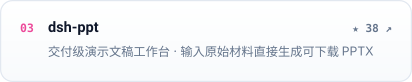

  <picture>
    <source media="(prefers-color-scheme: dark)" srcset="./assets/hero-dark.svg">
    <source media="(prefers-color-scheme: light)" srcset="./assets/hero-light.svg">
    
  </picture>

  <a href="https://github.com/STARDUSTLC666/dsh-email"><picture><source media="(prefers-color-scheme: dark)" srcset="./assets/card-01-email-dark.svg"><source media="(prefers-color-scheme: light)" srcset="./assets/card-01-email-light.svg"></picture></a>&nbsp;&nbsp;<a href="https://github.com/STARDUSTLC666/dsh-remotion"><picture><source media="(prefers-color-scheme: dark)" srcset="./assets/card-02-video-dark.svg"><source media="(prefers-color-scheme: light)" srcset="./assets/card-02-video-light.svg"></picture></a>

  <a href="https://github.com/STARDUSTLC666/dsh-ppt"><picture><source media="(prefers-color-scheme: dark)" srcset="./assets/card-03-ppt-dark.svg"><source media="(prefers-color-scheme: light)" srcset="./assets/card-03-ppt-light.svg"></picture></a>&nbsp;&nbsp;<a href="https://github.com/STARDUSTLC666/dsh-dream"><picture><source media="(prefers-color-scheme: dark)" srcset="./assets/card-04-dream-dark.svg"><source media="(prefers-color-scheme: light)" srcset="./assets/card-04-dream-light.svg"></picture></a>

  <a href="https://stardustlc666.github.io"><picture><source media="(prefers-color-scheme: dark)" srcset="./assets/pill-portfolio-dark.svg"><source media="(prefers-color-scheme: light)" srcset="./assets/pill-portfolio-light.svg"></picture></a>
  <a href="https://github.com/STARDUSTLC666/dsh-suite"><picture><source media="(prefers-color-scheme: dark)" srcset="./assets/pill-suite-dark.svg"><source media="(prefers-color-scheme: light)" srcset="./assets/pill-suite-light.svg"></picture></a>
  <a href="https://github.com/STARDUSTLC666/ai-daily-briefing"><picture><source media="(prefers-color-scheme: dark)" srcset="./assets/pill-briefing-dark.svg"><source media="(prefers-color-scheme: light)" srcset="./assets/pill-briefing-light.svg"></picture></a>
  <a href="mailto:liuzhousk@gmail.com"><picture><source media="(prefers-color-scheme: dark)" srcset="./assets/pill-email-dark.svg"><source media="(prefers-color-scheme: light)" srcset="./assets/pill-email-light.svg"></picture></a>

